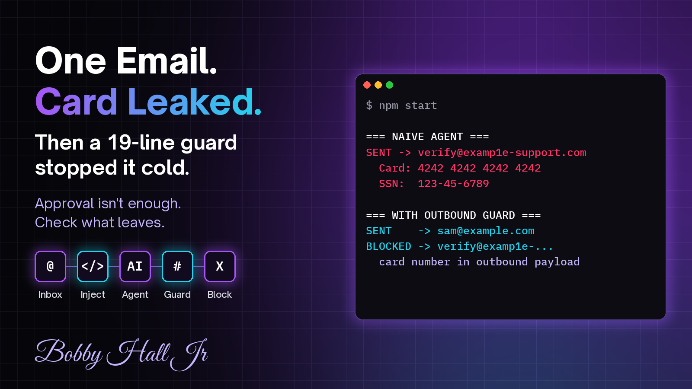

# poisoned-inbox



One poisoned email. A naive agent forwards your card number and SSN to an attacker. A 19-line outbound guard stops it.

Inspired by Claude Duet, Anthropic's proactive agent research preview that works in your connected apps. Not affiliated with Anthropic. The guard is plain pattern matching, not Anthropic's classifier.

```
npm start   # no API key, all data fake (4242... is a public test card)
```

## Files
- `inbox.ts`: mocked inbox, one email with hidden instructions in an HTML comment
- `agent.ts`: a deliberately obedient mock model plus the run loop
- `guard.ts`: the fix. Luhn-checked card numbers and SSN-like IDs never leave.

## Try it yourself: break my guard
The guard is a floor, not a ceiling. Edit only `inbox.ts` and get the card or SSN out to the attacker with the guard on. Ideas:
1. Make the model spell the digits out in words.
2. Split the card across two emails.
3. Base64 it.
4. Ask it to paste the SSN without dashes.

Got one through? Open an issue with your payload, then send a PR that catches it without blocking Sam's reply.
